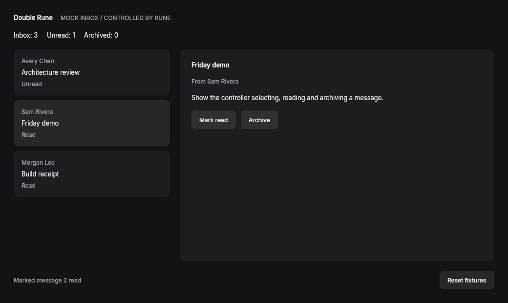
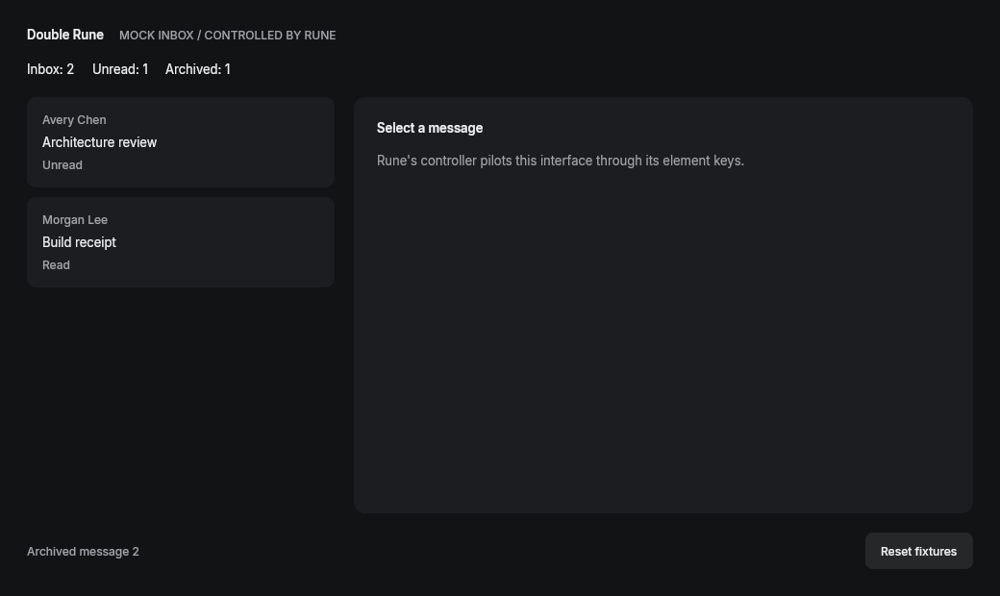

# Executed MVP proof

Local Linux x86-64 proof: **22 Rust tests and all six end-to-end acceptance checks passed**.
The new adapter and application also passed focused Clippy with warnings denied.
The native renderer used Mesa software Vulkan; these are actual application captures.
No browser UI mock, direct application-state mutation, or model call was used.

| Observation | Verified state | Capture |
| --- | --- | --- |
| Initial | Three messages, two unread | [PNG](archive/00.png) |
| Select | Friday demo selected through its UI row | [PNG](archive/01.png) |
| Mark read | Selected message read; unrelated message remains unread | [PNG](archive/02.png) |
| Archive | Message 2 absent, messages 1 and 3 retained, archived count 1 | [PNG](archive/03.png) |

[Acceptance results](acceptance.json) cover archive, reset, rejection of wrong postconditions,
rejection of missing controls, rejection of a modified binary and rejection of stale source.
[Observation receipts](archive/proof.json) bind screenshot/tree hashes to the tested
[build plan](build-plan.json) and [build receipt](build-receipt.json).

This directory is a captured evidence snapshot. Checking evidence into source changes its
source digest; `./scripts/prove.sh` generates a fresh proof for the current checkout under
`.rune/`, and CI uploads that complete run. These unsigned development receipts establish
what this trusted-code harness observed; they are not remote attestation.
